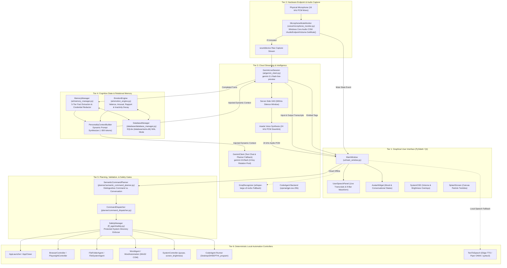

# System Architecture — DHEEPTHI-AI

## 1. Architectural Overview

**DHEEPTHI-AI** employs a **Decoupled Full-Duplex Architecture** designed to resolve the fundamental conflict between low-latency cloud conversational intelligence and safe operating system task automation. Rather than granting the cloud model direct command execution privileges, the system enforces a strict boundary between cognitive reasoning and local physical actuation.

---

## 2. Six-Tier Architectural Decomposition

### 2.1 Tier 1: Graphical User Interface (PySide6 / Qt 6)
- **Primary Modules:** `ui/main_window.py`, `ui/splash_screen.py`, `ui/widgets/*`.
- **Responsibilities:**
  - Manages the primary frameless application window and customized title bar (`ApplicationTitleBar`).
  - Renders the translucent glassmorphic HUD (`UserSpeechPanel`), displaying incoming user transcriptions with zero text clipping.
  - Houses the voice-reactive 9-bar audio waveform visualizer driven in real time by incoming microphone PCM amplitude.
  - Animates the visual avatar (`AvatarWidget`) reflecting emotional mood states and operational statuses (`IDLE`, `LISTENING`, `USER SPEAKING`, `SPEAKING`, `MUTED`).
  - Displays non-intrusive on-screen telemetry alerts (`SystemOSD`) for audio volume and screen brightness adjustments.

### 2.2 Tier 2: Hardware Endpoint & Audio Capture Tier
- **Primary Modules:** `voice/microphone_monitor.py`, `ui/main_window.py` (`GeminiLiveAudioWorker`).
- **Responsibilities:**
  - Ingests raw mono audio at 16,000 Hz, 16-bit PCM format via `sounddevice`.
  - Interfaces directly with the Windows Core Audio COM API (`IAudioEndpointVolume`) using `comtypes`.
  - Polls `GetMute()` every 250 ms to detect hardware-level mute activation (such as laptop physical hotkeys).
  - Severing audio uplink packets immediately upon mute detection, preventing audio transmission to cloud servers.

### 2.3 Tier 3: Cloud Streaming & Intelligence Tier
- **Primary Modules:** `ai/gemini_client.py` (`GeminiLiveSession`, `GeminiClient`), `voice/groq_recognizer.py`, `code_agent/agent.py`.
- **Responsibilities:**
  - Maintains persistent bidirectional WebSocket connections to `gemini-3.1-flash-live-preview`.
  - Operates server-side Voice Activity Detection calibrated with 600 ms silence duration.
  - Streams 24 kHz downlink audio synthesized using the prebuilt `Aoede` persona.
  - Coordinates multi-key rotation pools (`GEMINI_API_KEY_1..4`) to handle API quota exhaustion.
  - Provides cloud STT fallback using Groq `whisper-large-v3-turbo` via direct `httpx` multipart requests.
  - Connects to Groq `openai/gpt-oss-20b` for autonomous code generation.

### 2.4 Tier 4: Cognitive State & Relational Memory Tier
- **Primary Modules:** `ai/memory_manager.py`, `ai/emotion_engine.py`, `ai/personality_context_builder.py`, `database/database_manager.py`.
- **Responsibilities:**
  - Manages local SQLite relational persistence (`database/astra.db`) configured with `PRAGMA journal_mode=WAL`.
  - Maintains a 5-tier memory structure: working turns (`conversation_context`), semantic facts (`user_context`), milestones (`memory_episodes`), people entities (`people`), and commitments (`tasks`).
  - Enforces automated regex-based credential scrubbing to block passwords, tokens, and credit cards from permanent storage.
  - Runs an emotional state machine tracking valence, arousal, and rapport with a 15-minute inactivity decay mechanism.
  - Dynamically synthesizes a compact prompt block (~250–300 tokens) injecting active facts and emotional directives into the Live session.

### 2.5 Tier 5: Planning, Validation, & Safety Gates
- **Primary Modules:** `planner/semantic_command_planner.py`, `planner/command_dispatcher.py`, `ff_agent/safety.py`.
- **Responsibilities:**
  - Extracts inline `<ACTION>command</ACTION>` blocks emitted by Gemini Live.
  - Classifies natural language queries into over 40 supported intents, distinguishing informational conversations from actionable commands.
  - Decomposes chained tasks into sequential `ActionPlan` and `ActionStep` structures.
  - Enforces path boundary restrictions (`SafetyManager`), rejecting any attempt to alter `C:\Windows`, `System32`, or root partition files.

### 2.6 Tier 6: Deterministic Local Automation Controllers
- **Primary Modules:** `automation/*`, `productivity_agent/word/*`, `voice/text_to_speech.py`.
- **Responsibilities:**
  - **Applications:** Launches and closes Windows applications using indexed Start Menu paths, Registry records, and `psutil` (`AppLauncher`, `AppCloser`).
  - **Filesystem:** Safely searches, copies, moves, renames, compresses, and deletes files using `Send2Trash` (`FileFolderAgent`, `FileSystemAgent`).
  - **Browser:** Drives Chrome and Edge navigation, Google searches, and YouTube playback (`BrowserController`, `PlaywrightController`).
  - **Word:** Creates and populates Microsoft Word documents via Win32 COM automation (`WordAgent`, `WordAutomation`).
  - **Hardware & Peripherals:** Adjusts master volume via `pycaw`, display brightness, screen recordings, and screenshots (`SystemController`).
  - **Code Execution:** Compiles and runs generated Python/Java programs inside `~/Desktop/DHEEPTHI_program/`.
  - **Fallback TTS:** Delivers speech synthesis via Edge-TTS, local Piper ONNX, or Windows SAPI5 (`TextToSpeech`).

---

## 3. The Decoupled Security Model

The defining security principle of DHEEPTHI-AI is that **the cloud Large Language Model has zero operating system authority**:

1. **Isolation of Cloud Reasoning:** The cloud LLM cannot execute shell scripts, create processes, open files, or access the network. It receives only user audio/text and outputs conversational speech and declarative text tags (`<ACTION>`).
2. **Deterministic Local Interception:** The client application parses the `<ACTION>` tags and executes deterministic, locally compiled Python code.
3. **Safety Gate Verification:** Before executing any filesystem change or application launch, parameters are checked against strict path whitelists and safety constraints. Destructive or ambiguous operations require modal confirmation from the user.