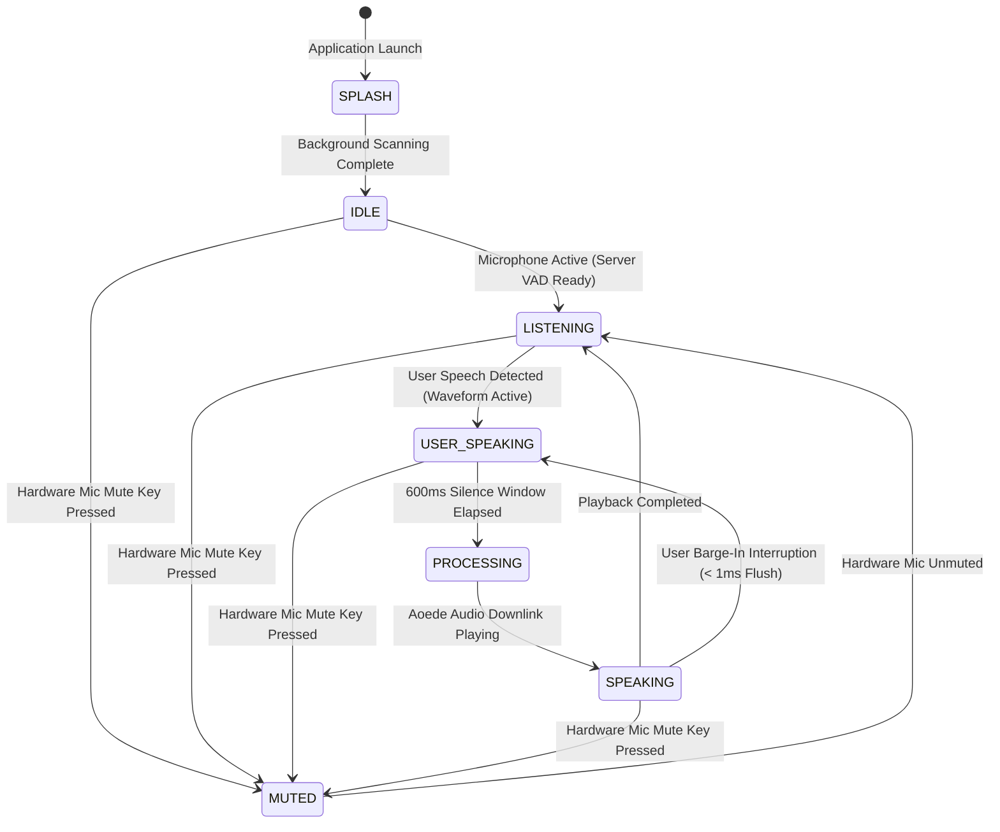

# UI Wireframe & Interface Architecture — DHEEPTHI-AI

This document specifies the graphical interface layout, widget hierarchy, visual states, and animation systems of DHEEPTHI-AI V1 built with **PySide6 (Qt 6.11)**.

---

## 1. Overall Dashboard Layout Wireframe

The interface employs a frameless, dark cyberpunk glassmorphism theme (`ui/styles/theme.py`) featuring translucent gradients, neon cyan/purple accents, and real-time audio visualization.

```text
+----------------------------------------------------------------------------------------------------+
|  [Logo] DHEEPTHI-AI v1.0                                                [_] Minimize  [^] Maximize  [X] Close  | <- ApplicationTitleBar
+----------------------------------------------------------------------------------------------------+
|                                                                                                    |
|  +---------------------+  +-----------------------------------------------------+  +---------------------+ |
|  |     LEFT PANEL      |  |                    CENTER STAGE                     |  |     RIGHT PANEL     | |
|  |  (System Telemetry) |  |                                                     |  |   (Activity & Memory)| |
|  |                     |  |                  +----------------+                 |  |                     | |
|  | +-----------------+ |  |                  |                |                 |  | +-----------------+ | |
|  | | StatusTile      | |  |                  |  AvatarWidget  |                 |  | | StatusTile      | | |
|  | | Connectivity    | |  |                  | (Mood & State) |                 |  | | Indexed Files   | | |
|  | | [Online: Live]  | |  |                  |                |                 |  | | [Count: 14,280] | | |
|  | +-----------------+ |  |                  +----------------+                 |  | +-----------------+ | |
|  |                     |  |                                                     |  |                     | |
|  | +-----------------+ |  |         +---------------------------------+         |  | +-----------------+ | |
|  | | StatusTile      | |  |         |        UserSpeechPanel          |         |  | | StatusTile      | | |
|  | | Active Model    | |  |         |  "Chrome open panni song play"  |         |  | | Memory Turns    | | |
|  | | [Gemini Live]   | |  |         |                                 |         |  | | [Session: #14]  | | |
|  | +-----------------+ |  |         |  | | | | | | | | |  (9-Bar VIZ) |         |  | +-----------------+ | |
|  |                     |  |         +---------------------------------+         |  | +-----------------+ | |
|  | +-----------------+ |  |                                                     |  | | StatusTile      | | |
|  | | StatusTile      | |  |                  +----------------+                 |  | | Hardware Mute   | | |
|  | | Audio Subsystem | |  |                  |   MicWidget    |                 |  | | [UNMUTED / COM] | | |
|  | | [16kHz / 24kHz] | |  |                  |    (🎤 / 🔴)   |                 |  | +-----------------+ | |
|  | +-----------------+ |  |                  +----------------+                 |  |                     | |
|  +---------------------+  +-----------------------------------------------------+  +---------------------+ |
|                                                                                                    |
|  +-----------------------------------------------------------------------------------------------+ |
|  | ConversationPanel: Scrollable Chat Bubbles & Execution Confirmation Prompts                    | |
|  +-----------------------------------------------------------------------------------------------+ |
+----------------------------------------------------------------------------------------------------+
| [SystemOSD Overlay: Floating Toast for Master Volume & Screen Brightness Adjustments]              |
+----------------------------------------------------------------------------------------------------+
```

---

## 2. Key UI Components & Widgets

### 2.1 Custom Window Title Bar (`ApplicationTitleBar`)
- **Module:** `ui/main_window.py` (lines 611–792).
- **Features:**
  - Frameless window integration using Windows API (`SetWindowLong`, `GWL_STYLE`).
  - Supports click-and-drag window movement across multi-monitor desktop setups.
  - Custom branding incorporating `dheepthi_logo-2.png`.
  - Native window controls: Minimize (`_`), Maximize/Restore (`^`), and Close (`X`).
  - Suppresses known Qt QFont point-size warnings triggered by title-bar control hover paths.

### 2.2 User Speech Panel HUD (`UserSpeechPanel`)
- **Module:** `ui/widgets/user_speech_panel.py`.
- **Features:**
  - Translucent glassmorphism container positioned prominently on the center dashboard.
  - Dynamically displays streaming user speech transcriptions with auto-scrolling and zero text overflow.
  - **9-Bar Voice Waveform Visualizer:** Nine vertical equalizer bars centered within the HUD, animated dynamically by real-time incoming microphone PCM amplitudes.
  - Transitions color states based on operational modes:
    - *Cyan Glow:* Active listening and incoming speech ingestion.
    - *Amber Pulse:* Assistant processing / semantic planning.
    - *Purple Shimmer:* Assistant speaking (`Aoede` voice output).
    - *Muted Red:* Hardware microphone mute active.

### 2.3 Interactive Visual Avatar (`AvatarWidget`)
- **Module:** `ui/widgets/avatar_widget.py`.
- **Features:**
  - Animated multi-layer avatar canvas rendering dynamic breathing rings, orbital halos, and facial expressions.
  - Visual states synchronize in real time with the underlying `EmotionEngine` state machine:
    - `neutral`: Balanced cyan rings with gentle breathing pulsation.
    - `happy`: Vibrant gold-yellow aura with accelerated orbital spin.
    - `caring`: Warm emerald-green glow with soothing outer expansion.
    - `hurt`: Subtle indigo-slate dimming with contracted orbits.
    - `annoyed`: Sharp crimson-amber spikes with rapid flicker.
    - `playful`: Bouncing multi-hue gradient shifts.

### 2.4 On-Screen Display Overlay (`SystemOSD`)
- **Module:** `ui/widgets/system_osd.py`.
- **Features:**
  - Non-modal, translucent HUD pill that pops up in the top-right corner during volume or brightness adjustments.
  - Displays numerical percentage (e.g., `Volume: 70%`) alongside an animated fill bar, automatically fading out after 2 seconds.

### 2.5 Candidate File Selection Panel (`FileSelectionPanel`)
- **Module:** `ui/widgets/file_selection_panel.py`.
- **Features:**
  - Displayed dynamically when a spoken filesystem command matches multiple candidate files (e.g., "Open report").
  - Presents an enumerated list of candidate paths allowing one-click selection or voice-directed ordinal selection ("open the second one").

---

## 3. Startup Splash Screen (`SplashScreen`)

- **Module:** `ui/splash_screen.py`.
- **Visual Design:**
  - Hardware-accelerated canvas particle system featuring 80 drifting, twinkling stars.
  - Radial glowing central insignia with animated neon pulse rings.
  - Dual-phase glowing progress bar tracking background `InitializationWorker` progress (Start Menu scanning $\rightarrow$ Filesystem indexing).
  - Cross-dissolve alpha transition smoothly revealing the maximized `MainWindow` upon completion.

---

## 4. UI Operational State Transitions

