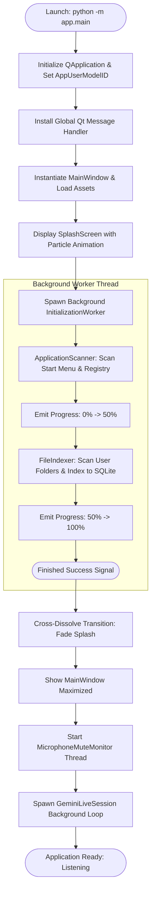
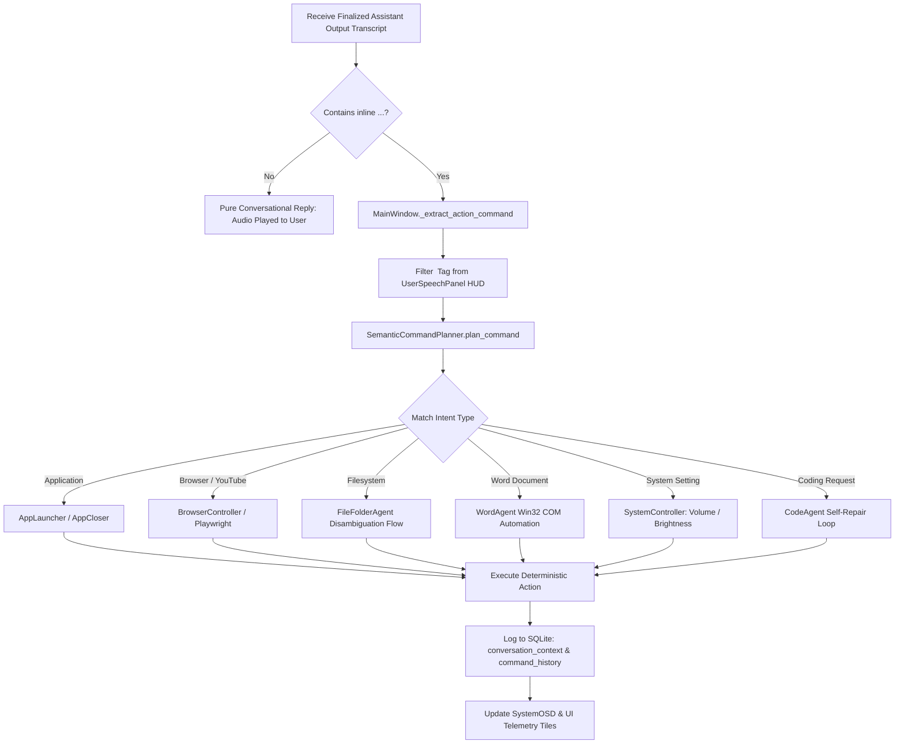
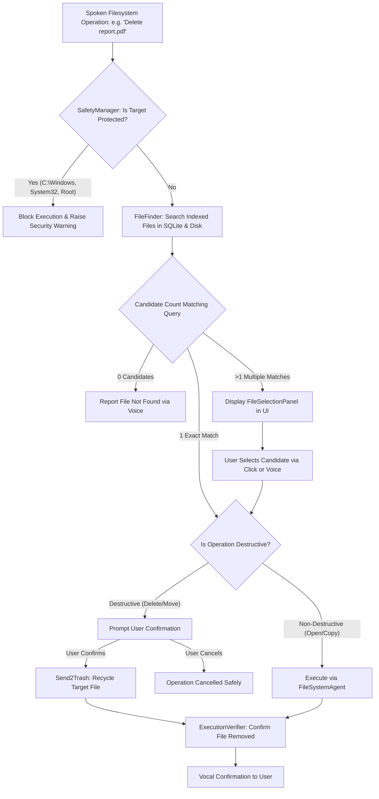
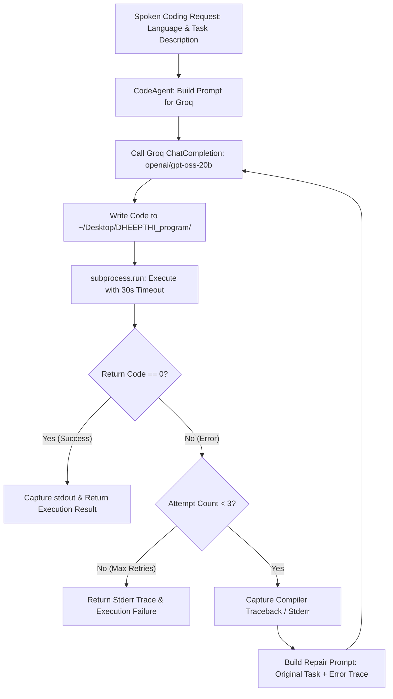
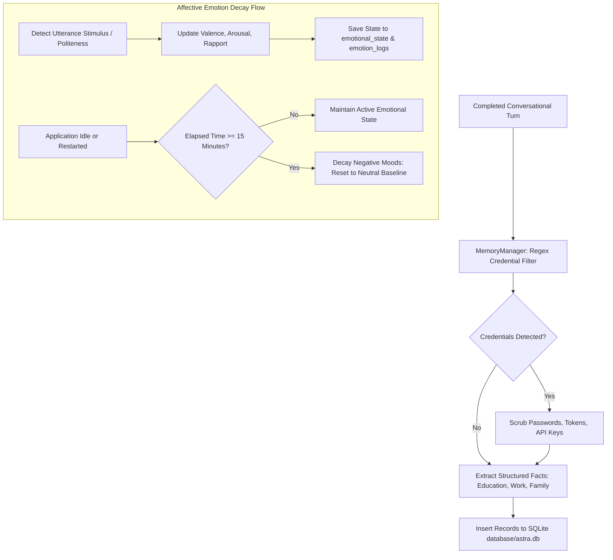

# System Flowcharts — DHEEPTHI-AI

This document provides comprehensive flowcharts detailing the primary runtime lifecycles and decision processes of DHEEPTHI-AI V1.

---

## 1. Application Startup & Background Initialization Lifecycle



---

## 2. Full-Duplex Voice Streaming & Barge-In Interruption Flow

```mermaid
flowchart TD
    MIC_IN[User Speaks into Physical Microphone] --> COM_CHECK{MicrophoneMuteMonitor: Is Endpoint Muted?}
    COM_CHECK -- Yes --> DISARM[Disarm Uplink & Switch UI to MUTED]
    COM_CHECK -- No --> CAPTURE[sounddevice: 16 kHz Mono PCM Capture]
    
    CAPTURE --> STREAM_UP[Send PCM Uplink to Gemini Live WebSocket]
    STREAM_UP --> VAD_EVAL{Server VAD: Silence >= 600ms?}
    VAD_EVAL -- No --> STREAM_UP
    VAD_EVAL -- Yes --> GEN_DOWN[Generate 24 kHz Aoede Downlink Audio & Transcript]
    
    GEN_DOWN --> PLAY_START[Enqueue PCM Chunk to Output Buffer & Play]
    
    subgraph Playback_And_Barge_In ["Playback & Barge-In Detection"]
        PLAY_START --> PLAYING[Audio Playing through Speakers]
        PLAYING --> CHECK_INTERRUPT{User Speaks Mid-Playback?}
        CHECK_INTERRUPT -- No --> PLAY_DONE[Playback Completes Normally]
        CHECK_INTERRUPT -- Yes --> VAD_START[Server VAD Emits START Event]
        VAD_START --> FLUSH[GeminiLiveAudioWorker.interrupt_and_flush]
        FLUSH --> STOP_SPEAKER[Cease Speaker Output (< 1ms)]
        STOP_SPEAKER --> CLEAR_QUEUE[Flush Local Queue & Invalidate Response ID]
        CLEAR_QUEUE --> DROP_STALE[Drop In-Flight Stale Cloud Packets]
        DROP_STALE --> NEW_TURN[Transition to USER SPEAKING State]
    end
```

---

## 3. Spoken Command Dispatch & Local Execution Flow



---

## 4. Filesystem Disambiguation & Safety Flow



---

## 5. Autonomous Code Agent Self-Repair Flow



---

## 6. Cognitive Memory Extraction & Inactivity Mood Decay Flow

