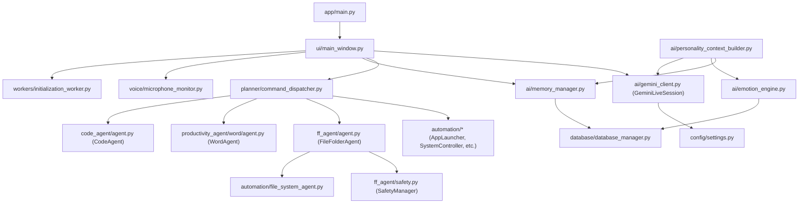

# Repository Analysis — DHEEPTHI-AI

## 1. Executive Repository Overview

The DHEEPTHI-AI repository comprises **68 active Python source files** (excluding external virtual environments, git metadata, and bytecode caches), organized by functional separation of concerns:

```text
c:\Users\nares\Documents\DHEEPTHI-AI\
├── ai/                 # Gemini Live, GeminiClient, MemoryManager, EmotionEngine
├── app/                # Application entry point & Qt message filtering
├── automation/         # Windows OS controllers, process scanner, file/browser automation
├── code_agent/         # Autonomous programming agent (Groq-driven compile-repair loop)
├── config/             # Configuration defaults & environment schemas
├── core/               # In-memory context manager & pronoun resolver
├── database/           # SQLite database manager (14 relational tables, WAL pragma)
├── docs/               # Technical specifications & system documentation
├── ff_agent/           # Safe file & folder agent with disambiguation workflow
├── models/piper/       # Local ONNX neural TTS model & configuration
├── planner/            # Semantic command planner, intent detector, action models
├── productivity_agent/ # Win32 COM Microsoft Word automation & verifier
├── tests/              # 63 automated test suites
├── tools/              # 15 performance profiling & verification scripts
├── ui/                 # PySide6 HUD dashboard, widgets, styles, & particle splash
├── utils/              # Utility stubs
├── vision/             # Gemini Cloud Vision & Cloud OCR engine
├── voice/              # Core Audio COM mute monitor, multi-engine TTS fallback
└── workers/            # Asynchronous startup indexing thread
```

---

## 2. Main Entry Points & Bootstrap Sequence

### Primary Entry Point: `app/main.py`
The application is launched via the module command:
```powershell
python -m app.main
```

### Execution Flow:
1. **Windows AppUserModelID Assignment:** Calls `ctypes.windll.shell32.SetCurrentProcessExplicitAppUserModelID("ASTRA.AI.Desktop.v1")` ensuring proper Windows taskbar grouping and icon attribution.
2. **Global Qt Message Filtering:** Installs `dheepthi_qt_message_handler()`, which suppresses benign `QFont::setPointSize: Point size <= 0` warnings triggered by mouse hover over customized window title bars.
3. **Application Instantiation:** Creates the `QApplication` instance, sets the application name to `"DHEEPTHI-AI"`, and assigns `ui/assets/dheepthi.ico`.
4. **Main Window Creation:** Instantiates `MainWindow` (`ui/main_window.py`), maximizes the window, and invokes `app.processEvents()` to paint the initial frame.
5. **Deferred Initialization:** Enqueues `QTimer.singleShot(0, window.initialize_application)` so heavy background threads spawn only after the visual canvas is fully presented.

---

## 3. Directory & Module Responsibilities

| Directory | Core Purpose | Important Classes & Functions | Key Dependencies | Implementation Status |
|:---|:---|:---|:---|:---|
| `ai/` | Real-time WebSocket streaming, LLM clients, memory, & emotions | `GeminiLiveSession`, `GeminiClient`, `MemoryManager`, `EmotionEngine`, `PersonalityContextBuilder` | `google.genai`, `groq`, `sqlite3` | **Implemented & Verified** |
| `app/` | Application bootstrap & error filtering | `main()`, `dheepthi_qt_message_handler()` | `PySide6`, `ctypes` | **Implemented & Verified** |
| `automation/` | Operating system, process, browser, & peripheral automation | `AppLauncher`, `AppCloser`, `ApplicationScanner`, `BrowserController`, `FileSystemAgent`, `SystemController` | `pyautogui`, `pywinauto`, `pycaw`, `psutil`, `Send2Trash` | **Implemented & Verified** |
| `code_agent/` | Automated code synthesis & compilation | `CodeAgent` | `groq`, `subprocess`, `pathlib` | **Implemented & Verified** |
| `config/` | Environment variables & system constants | Constants in `settings.py` | `python-dotenv` | **Implemented & Verified** |
| `core/` | In-memory conversational state tracking | `ContextManager` | `collections.deque`, `threading.RLock` | **Implemented & Verified** |
| `database/` | Relational SQLite persistence | `DatabaseManager`, `CommandRow` | `sqlite3`, `threading.RLock` | **Implemented & Verified** |
| `ff_agent/` | Safe file/folder agent with path gating | `FileFolderAgent`, `SafetyManager`, `ContextResolver` | `RapidFuzz`, `pathlib` | **Implemented & Verified** |
| `planner/` | Semantic intent classification & dispatch | `SemanticCommandPlanner`, `CommandDispatcher`, `IntentDetector`, `ActionPlan` | `RapidFuzz`, `re` | **Implemented & Verified** |
| `productivity_agent/` | Microsoft Word COM automation suite | `WordAgent`, `WordAutomation`, `WordVerifier` | `win32com.client`, `comtypes` | **Implemented & Verified** |
| `ui/` | PySide6 HUD interface & visual widgets | `MainWindow`, `SplashScreen`, `UserSpeechPanel`, `AvatarWidget`, `SystemOSD` | `PySide6.QtWidgets`, `sounddevice` | **Implemented & Verified** |
| `vision/` | Cloud screen understanding & OCR | `GeminiVision`, `OCREngine` | `google.genai` | **Implemented & Verified** |
| `voice/` | Core Audio COM mute, multi-engine TTS | `MicrophoneMuteMonitor`, `TextToSpeech`, `PiperTTSEngine`, `EdgeTTSEngine` | `comtypes`, `sounddevice`, `edge-tts`, `piper-tts`, `onnxruntime` | **Implemented & Verified** |
| `workers/` | Asynchronous startup indexing | `InitializationWorker` | `PySide6.QtCore.QThread` | **Implemented & Verified** |

---

## 4. Key Cross-Module Dependencies



---

## 5. Implementation Status Summary

- **Fully Implemented and Verified Subsystems:**
  - Real-time Gemini Live bidirectional streaming session (`ai/gemini_client.py`).
  - Sub-millisecond barge-in interruption queue flushing (`ui/main_window.py`).
  - Core Audio COM hardware microphone mute monitoring (`voice/microphone_monitor.py`).
  - Trilingual Tanglish NLU and respectful conversational boundaries (`ai/gemini_client.py`).
  - Decoupled `<ACTION>` tag extraction and semantic command planning (`planner/semantic_command_planner.py`).
  - Local process automation (`automation/app_launcher.py`, `app_closer.py`).
  - Safe filesystem agent with candidate disambiguation (`ff_agent/agent.py`, `automation/file_system_agent.py`).
  - Win32 COM Microsoft Word synthesis (`productivity_agent/word/automation.py`).
  - Autonomous code agent with compile-repair loop (`code_agent/agent.py`).
  - 5-tier relational memory persistence in SQLite (`database/database_manager.py`).
  - Multi-engine TTS fallback (Edge-TTS $\rightarrow$ Piper ONNX $\rightarrow$ pyttsx3).
  - PySide6 HUD dashboard with 9-bar reactive audio visualizer.
- **Partially Implemented / Unverified Subsystems:**
  - Playwright browser controller (`automation/playwright_controller.py`): code complete but runtime dependent on active Chrome remote debugging port 9222.
  - File modification watcher (`automation/file_monitor.py`): implemented using `watchdog` but not hooked into primary UI dispatch loop.
- **Missing / Deprecated Stubs:**
  - `voice/speech_recognition.py` (0 bytes) and `utils/logger.py` (0 bytes): legacy file stubs left after transitioning to Gemini Live.
