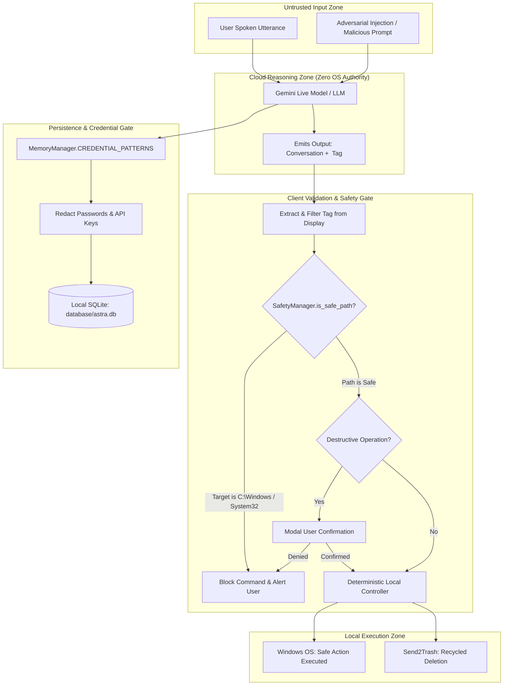

# Security, Privacy, and Safety Specification — DHEEPTHI-AI

This document provides a formal security, privacy, and safety specification for DHEEPTHI-AI V1, detailing the threat model, implemented safeguards, and residual operational risks.

---

## 1. Threat Model & Security Boundaries

Desktop voice assistants operating with system automation permissions face distinct threat vectors compared to traditional web chatbots:

1. **Prompt Injection & Indirect Jailbreaks:** Adversaries or untrusted web content attempting to trick the LLM into generating destructive system commands (e.g., deleting user directories, altering system settings, or disclosing private secrets).
2. **Unauthorized Operating System Execution:** Cloud reasoning models executing unvetted shell commands directly on the host machine.
3. **Data Leakage & Sensitive Credential Exposure:** Spoken passwords, API keys, or credit cards becoming permanently recorded in local databases or transmitted to third-party endpoints.
4. **Physical Eavesdropping & Audio Interception:** Background ambient audio streaming to cloud servers without user awareness or during hardware mute states.

---

## 2. Implemented & Verified Safeguards

### 2.1 The Decoupled Zero-Execution-Authority Principle
- **Verified Implementation:** The cloud Large Language Model possesses **zero operating system authority**. It has no capability to invoke `subprocess`, spawn shell processes, read disk files, or execute Python code directly.
- **Execution Mechanism:** The model outputs natural language dialogue containing standardized declarative tags (`<ACTION>standardized command</ACTION>`).
- **Client Mediation:** The local Python desktop client extracts these tags, filters them from user-facing UI, passes them through `SemanticCommandPlanner` for intent validation, and routes them to deterministic, locally compiled Python controllers.

### 2.2 Filesystem Path Boundary Enforcement (`SafetyManager`)
- **Verified Implementation:** Implemented in `ff_agent/safety.py`.
- **Protected Paths:** Rejects any modification, movement, or deletion request targeting:
  - Operating system directories: `C:\Windows`, `C:\Windows\System32`.
  - Application binaries: `C:\Program Files`, `C:\Program Files (x86)`.
  - Partition roots: `C:\`, `D:\`.
  - Hidden system files and directories.
- **Recycle Bin Integration:** All destructive file deletion actions invoke `Send2Trash.send2trash(path)` rather than `os.remove()`, ensuring deleted files remain recoverable from the Windows Recycle Bin.

### 2.3 Pre-Persistence Credential Scrubbing
- **Verified Implementation:** Implemented in `ai/memory_manager.py` (`CREDENTIAL_PATTERNS`).
- **Scrubbing Scope:** Scans all conversation turns prior to database commitment using regular expressions matching:
  - Passwords, passcodes, and PIN numbers (`password`, `passwd`, `pin`, `pwd`).
  - One-Time Passwords (`otp`).
  - Google API keys (`AIza[0-9A-Za-z_-]{35}`).
  - Groq API keys (`gsk_[a-zA-Z0-9]{20,}`).
  - OpenAI API keys (`sk-[a-zA-Z0-9]{20,}`).
  - Generic bearer tokens, access tokens, and high-entropy secret strings.
  - Credit card numbers, CVVs, and payment identifiers.
- **Redaction Behavior:** Replaces detected credential tokens with sanitized placeholder strings before writing to `conversation_context` or `user_context`.

### 2.4 Hardware Endpoint Microphone Protection
- **Verified Implementation:** Implemented in `voice/microphone_monitor.py`.
- **Mechanism:** Monitors the Windows Core Audio COM interface (`IAudioEndpointVolume.GetMute()`) every 250 ms.
- **Privacy Guarantee:** When the laptop's physical microphone mute switch is activated, audio packet transmission to Google GenAI is disarmed at the operating system capture endpoint level.

### 2.5 Relational User Profile Isolation
- **Verified Implementation:** Implemented in `database/database_manager.py`.
- **Mechanism:** All persistent records in `user_context`, `conversation_context`, `command_history`, `personal_memories`, and `people` include a mandatory foreign key `profile_id`.
- **Privacy Guarantee:** Prevents cross-profile data leakage in multi-user desktop environments.

---

## 3. Residual Security Limitations & Recommended Mitigations

| Identified Vulnerability | Severity | Source Evidence | Practical Risk | Recommended Mitigation |
|:---|:---:|:---|:---|:---|
| **Host Subprocess Execution in CodeAgent** | **High** | `code_agent/agent.py` executes code via `subprocess.run([sys.executable, script])` | Malicious or buggy generated code executes with the user's desktop privileges, potentially altering files or consuming resources | Run generated code inside an isolated Windows Sandbox, restricted AppContainer, or Docker container |
| **Hardcoded Author Metadata** | **Medium** | `ai/memory_manager.py:STATIC_CREATORS = ["Naresh", "Ragavendhiran"]` | Hardcoded author metadata leaks into multi-user context and requires code edits to reassign ownership | Externalize system owner and developer metadata into configurable environment variables or user profile database records |
| **Unencrypted SQLite Storage** | **Medium** | `database/astra.db` uses standard SQLite without page-level encryption | Anyone with physical access to the workstation filesystem can read past conversation logs | Integrate SQLite encryption extension (SQLCipher) using user-supplied master keys or Windows DPAPI |
| **Acoustic Echo Loopback Risk** | **Medium** | Open microphone capture during speaker playback | If laptop microphone lacks hardware acoustic echo cancellation (AEC), assistant speech may re-enter audio stream | Implement local software acoustic echo suppression or enforce push-to-talk when external speakers are connected |
| **Cloud Vision Privacy Exposure** | **Low** | `vision/gemini_vision.py` sends entire desktop screenshots to Google Cloud | Sensitive private desktop windows (banking, personal messages) could be transmitted off-device | Provide an on-screen preview dialog or bounding-box crop tool before transmitting screenshots to cloud endpoints |

---

## 4. Safety Architecture Diagram

